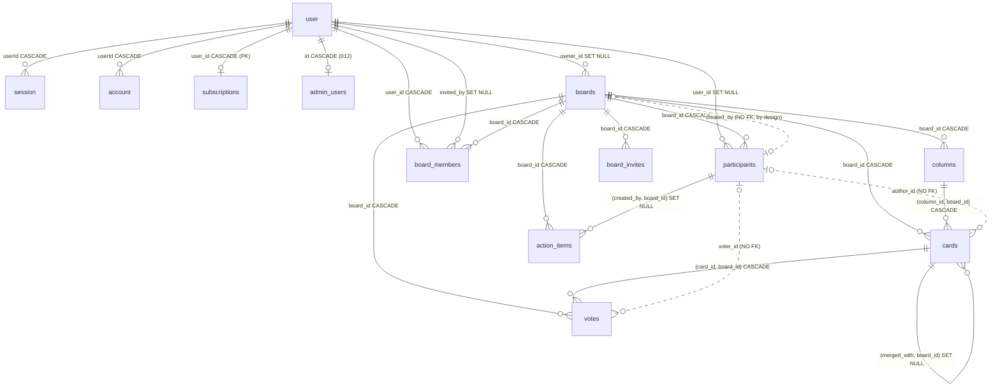

# Schema audit: RetroBoard (Neon Postgres 17)

Date: 2026-11-17. Branch: `feature/trust-foundation`. Line numbers refer to commit `c013290`.
Scope: the OLTP application database. Judged on normalisation, keys, referential integrity, constraints, index fit to the real query workload, and round-trips per request.
Evidence: the live `dev` Neon branch only (`ep-calm-breeze`). Production was not touched.
Companion migration: `scripts/migrations/012_schema_hardening.sql` (applied to dev).

## Bottom line

1. **The schema is in reasonable shape.** Every table has a primary key. Every parent/child relationship that should cascade does. All timestamps are `timestamptz`. Every foreign-key column used for joins or deletes is indexed except one, which 012 fixes.
2. **Index choice is not what limits user-facing speed, and won't be for a long time.** Every hot query runs in 0.02 to 0.5 ms on the server. One Neon HTTP round-trip measured about 30 ms from a laptop. From a Vercel function in the same region it will be lower, but still 10 to 100 times the execution time. A signed-in board load makes about 10 sequential database round-trips. The biggest available speedup is cutting round-trips in the route code (section 7).
3. **The most important correctness problem is lost updates on the two JSONB columns,** and it is in the code, not the schema. Card reactions and board settings are rewritten as whole blobs from the client's copy. Two people reacting or changing settings at the same moment can silently erase each other's change.
4. **012 adds what the data already obeys.** It turns the "same board" invariants on the denormalised `board_id` columns, the `trust_version` and `join_code` domains, and four smaller rules into database-enforced constraints. Every one had zero violating rows on dev.

## 1. Current ERD



Standalone tables: `feature_flags`, `app_settings` (enforced singleton), `free_access` (email allowlist), `verification` (Better Auth).
The composite `(x, board_id)` keys were added by 012. The single-column FKs they extend are still in place.

## 2. Grain and key per table

| Table | Grain (one row per…) | Key | Notes |
|---|---|---|---|
| boards | retrospective board | `id` text, 10-char nanoid (URL) | `join_code` unique; `archived_at` = completed; `deleted_at` = in Trash |
| columns | column on a board | `id` text, client-generated | ordered by `(board_id, position)` |
| cards | sticky note | `id` text, client-generated | `board_id` denormalised from column; `reactions` JSONB map |
| votes | (card, voter) vote | `id` uuid; natural key `(card_id, voter_id)` unique | `board_id` denormalised from card |
| participants | person's presence on one board | `id` text (uuid on v1, server nanoid on v2) | `user_id` optional link to an account |
| action_items | follow-up from a retro | `id` uuid | `assignee` free text by design |
| board_members | (board, account) access grant | `id` uuid; natural key `(board_id, user_id)` unique | `role` also says "owner", which duplicates `boards.owner_id` |
| board_invites | email invite | `id` uuid; `token` unique | **unused**: 0 rows, no code reads or writes it |
| admin_users | system admin grant | `id` = `user.id` | `email` duplicates `user.email` |
| feature_flags | flag | `id` uuid; `key` unique | |
| app_settings | the app (singleton) | fixed uuid, enforced by CHECK | `board_retention_days` is stored but never enforced |
| subscriptions | account's Paddle subscription | `user_id` | from 010; empty |
| free_access | allowlisted email | `email` | from 010; empty |
| user / session / account / verification | Better Auth | text ids | owned by Better Auth; not altered |

Naming is mostly consistent: snake_case, `*_at` for timestamps, `is_*` for booleans, `idx_*` for indexes. The exceptions are listed in section 9.

## 3. Drift between the database and the repo

The live dev schema matches `scripts/migrate.sql` plus migrations 002 to 009 and 011 column-for-column, including constraint names, defaults and the three `updated_at` triggers. Nothing in the database is unexplained except:

| Drift | Detail | Recommendation |
|---|---|---|
| Better Auth tables and their 3 indexes | `user`, `session`, `account`, `verification`, `account_userId_idx`, `session_userId_idx`, `verification_identifier_idx` are created by the Better Auth CLI, not by repo SQL. 002 references `"user"`, so the CLI must run first. | Document the bootstrap order (migrate.sql, Better Auth migrate, then 002 onward). They already have every index Better Auth recommends: `user.email`, `session.token`, `session.userId`, `account.userId`, `verification.identifier`. No change needed. |
| 010 missing from this branch | `subscriptions` and `free_access` exist on both Neon branches, but `010_billing_paddle.sql` exists only on `feature/phase0-billing`. | Cherry-pick the 010 file onto the main line. 012 skips its billing steps if those tables are absent, so 012 never fails on a fresh build. |
| No 001 | `migrate.sql` is effectively 001. Its header says it merges the Supabase-era "001_initial_schema" and "002_admin_console", which is a different 002 from `migrations/002_user_accounts.sql`. | Rename or annotate to avoid confusion. |
| No migration ledger | Nothing records which migrations a database has. Today the only way to tell is to inspect columns. | Proposal P10: add a `schema_migrations` table. |
| Non-idempotent early migrations | 002, 003, 004 and 009 have no `IF NOT EXISTS`. 004 also rewrites data. | Leave them as they are. Never re-run them. |

## 4. Query workload (from every `sql` call in `app/` and `lib/`)

Hot means it runs on every board interaction or page load. There are no direct SQL calls in server components; all access goes through route handlers.

| Path (file) | Heat | Tables: WHERE / JOIN / ORDER | Index used today |
|---|---|---|---|
| `loadBoardActor` (lib/board-actor.ts:33, 52), runs on every board read and write | hot | boards `id, deleted_at IS NULL`; participants `id, board_id` | `idx_boards_deleted_at_null`; `participants_pkey` |
| `loadBoardAuthorityFor` (lib/auth-helpers.ts:78), every signed-in request | hot | boards `id`; board_members `(board_id, user_id)`; admin_users `id` | pkey; unique `(board_id,user_id)`; pkey |
| Board GET (app/api/boards/[boardId]/route.ts:31, 64-70, 86) | hot | boards `id`; columns/cards/votes/action_items/participants `board_id` ORDER BY `position` / `created_at` | `boards_pkey`; `idx_columns_ordering`; `idx_cards_board_id` + sort; `idx_votes_board_id`; `idx_action_items_status`; `idx_participants_board_id` |
| Card create/patch/delete (cards/route.ts) | hot | columns `(id, board_id)`; cards `(id, board_id)`; participants `(id, board_id)` | pkeys |
| Vote toggle (votes/route.ts:46, 50, 66) | hot | cards `(id, board_id)`; votes `(card_id, voter_id, board_id)`; votes `(board_id, voter_id)` count | `cards_pkey`; `idx_votes_card_id`; bitmap AND of `idx_votes_voter_id` and `idx_votes_board_id` (before 012) |
| Join by code (app/api/boards/join/route.ts:16) | hot | boards `join_code, deleted_at IS NULL` | `idx_boards_join_code` (exact duplicate of the unique index) |
| Join board (join/route.ts:44, 78, 101, 108) | hot | participants `(board_id, user_id)` ORDER BY `is_admin, joined_at`; boards/board_members ownership | `idx_participants_user_id` (partial) |
| Dashboard list (app/api/user/boards/route.ts:36-75) | warm | boards LEFT JOIN board_members `(board_id, user_id)`; `owner_id = $u OR bm.user_id = $u`; 3 correlated counts per board | **Seq scan of boards** (the OR across the join blocks index use) |
| User stats (app/api/user/stats/route.ts:19) | warm | boards with EXISTS on participants/board_members; cards `author_id`, votes `voter_id`, action_items `created_by` IN (user's participants) | `idx_boards_archived_at` as a scan of all active boards; seq scans on cards/votes at this size |
| Trash list + lazy purge (user/boards/route.ts:20-34) | cold | boards `deleted_at < now()-30d`; boards `owner_id, deleted_at IS NOT NULL` | `idx_boards_deleted_at`; `idx_boards_owner_id` |
| Board create (app/api/boards/route.ts:31, 38) | warm | boards `join_code` probe; 1 HTTP transaction for the inserts | unique join_code |
| Admin pages (app/api/admin/*) | cold | boards counts, `title ILIKE`, ORDER BY `created_at DESC` LIMIT/OFFSET; `board_id = ANY()` group counts | `idx_boards_created_at`; seq scans (fine for admin) |

No N+1 loops exist. Every list endpoint is a single query or a fixed `Promise.all`. The latency problem is sequential awaits (section 7).

## 5. Findings, ranked by user impact

Severity reflects impact on users today and as the product grows. "012" says whether the migration addresses it.

### F1. High (latency): too many sequential round-trips per request. 012: no (code)
- **Evidence:** a signed-in v2 board GET runs these awaits in sequence:
  1. board row (route.ts:31)
  2. Better Auth session (route.ts:36)
  3. `loadBoardActor`: board row again (board-actor.ts:33), session again (:43), authority (:45), participant (:52)
  4. 5 child queries in parallel (route.ts:64)
  5. the same authority check again (route.ts:86)

  That is about 10 sequential round-trips, counting Better Auth's session lookup as 1 to 2 queries. The server-side work for all of them totals under 1 ms (section 6).
- **Risk:** every board open, card, vote and join waits on network latency. At roughly 30 ms per trip from a laptop, that is around 300 ms for a board GET. From Vercel in us-east-1 it will be less, but this was not measured from Vercel.
- **Recommendation:** section 7. The board GET can get down to 1 or 2 round-trips, and a vote to 2.

### F2. High (correctness): lost updates on JSONB read-modify-write. 012: no (code/model)
- **Reactions:** `cards.reactions` is replaced wholesale from the client's map (cards/route.ts:152). The v2 guard compares against a copy read earlier (:108, :121). Two people reacting to the same card at the same moment means one reaction silently disappears. Votes don't have this problem because they are rows with a unique key.
- **Settings:** the client sends its whole local settings object (stores/boardStore.ts:327-335) and the server overwrites the column (route.ts:183). Settings mixes durable configuration (`card_visibility`, voting) with volatile state (`timer`, `highlighted_card_id`). So a facilitator starting the timer can undo a co-facilitator's reveal made a second earlier.
- **Recommendation:**
  - Settings: merge on the server with `UPDATE boards SET settings = settings || $patch::jsonb` and send only the changed keys. That is a one-statement change and also saves the read.
  - Reactions: either apply the actor's own change in SQL (`jsonb_set` on `reactions`, adding or removing the actor's id from one emoji array in a single UPDATE), or normalise to `card_reactions(card_id, participant_id, emoji)` with a primary key, like votes (proposal P3).
- No SQL ever filters on a field inside either JSONB column, so neither needs to become real columns for query reasons. The reason to split them is concurrency.

### F3. Medium-high (integrity): denormalised `board_id` was only app-enforced. 012: yes
- **Evidence:** `cards`, `votes` and `action_items` carry `board_id` next to a parent that has its own `board_id`. Every route authorises by `board_id`. Before 012, only app pre-checks kept them consistent: cards.ts:55, :128, :132; votes.ts:46; action-items.ts:40.
- **Data:** 0 mismatches on dev (cards vs column, votes vs card, merged card vs target, action item creator vs board).
- **Done in 012:**
  - Unique keys on `(id, board_id)` for `columns`, `cards` and `participants`.
  - Composite FKs: `cards(column_id, board_id)`, `votes(card_id, board_id)`, `cards(merged_with, board_id)` with `SET NULL (merged_with)`, and `action_items(created_by, board_id)` with `SET NULL (created_by)`.
- **Verified on dev,** each in a rolled-back transaction:
  - Cross-board column move, vote, merge and action-item creator are all rejected.
  - Same-board vote insert is accepted.
  - Card delete with votes, column delete with cards, participant delete with action items, and a full board purge (18 cards, 8 of them merged, plus 4 votes) all cascade cleanly.

### F4. Medium (integrity): votes and cards don't reference participants. 012: no (owner decision P1)
- **Evidence:** no FK on `cards.author_id` or `votes.voter_id`. Dev has 10 orphaned cards and 10 orphaned votes. All 20 are on 10 v1 e2e boards created today, where the client claims an id that never joined. Rows copied from production on 11-16 have 0 orphans, but production itself was not checked.
- **Also:** removing a participant (participants/route.ts:95) leaves their votes counting and their cards attributed to a missing id.
- **Why not in 012:** v1 boards (104 on dev) let the client choose `author_id`/`voter_id` by design, so an FK would break v1 writes and the e2e suite.
- **Recommendation:** once v1 is retired, add FKs. Votes: `ON DELETE CASCADE`. Cards: decide between keeping them with `author_name` and nulling `author_id`, or cascading.
- `boards.created_by` correctly has no FK. The v2 creator cookie exists before its participant row: 48 boards on dev have no creator participant, 22 of them v1 boards created since August.

### F5. Medium (scaling ceiling): join codes are unique across every board ever created. 012: no (owner decision P2)
- **Evidence:** `uq_boards_join_code` covers all 100,000 five-digit codes, including completed and trashed boards. Creation probes up to 10 random codes (boards/route.ts:29-34). The chance all 10 collide is (N/100000)^10: about 3% at 70k boards, 11% at 80k, 35% at 90k. Each collision also costs one round-trip.
- Dev is already at 619 boards because the e2e suite creates hundreds per run.
- **Recommendation:** make the uniqueness partial over live boards (`WHERE deleted_at IS NULL`, optionally also `archived_at IS NULL`), and/or lengthen codes. Separately, the pre-check loop can be replaced by "insert and retry on unique violation 23505", which saves one round-trip per create.

### F6. Medium (uniqueness): one signed-in user can have several participants on a board. 012: no (owner decision P4)
- **Evidence:** join/route.ts:44-105 is check-then-insert with no unique key. Dev has 1 violating group: board `fMQV6sJkOE`, 3 rows from April 2026 (v1). The data predates the copy, so production almost certainly has it too.
- **Why not in 012:** a partial unique index on `participants(board_id, user_id) WHERE user_id IS NOT NULL` would fail on that group. Fixing it means repointing `cards.author_id`, `votes.voter_id` and `action_items.created_by` to one kept row, which is a data rewrite.
- **Recommendation:** dedupe (owner approval needed), add the partial unique index, then turn the join into `INSERT … ON CONFLICT … DO UPDATE`. That removes the race and one round-trip.

### F7. Low-medium (determinism): ties in `position`. 012: no (code)
- **Evidence:** 91 `(column_id, position)` groups on dev have duplicate positions, plus 1 `(board_id, position)` group for columns. A drag move persists only the moved card's position (boardStore.ts:675-704).
- **Risk:** `ORDER BY position` (route.ts:65-66) returns tied rows in arbitrary order, so manually sorted columns can reshuffle between refreshes.
- **Fix:** `ORDER BY position, created_at, id`. A unique constraint here would be wrong, because it would block the current move logic.

### F8. Low today, grows with data: dashboard and stats scan all boards. 012: no (code)
- **Evidence:**
  - The dashboard's `owner_id = $u OR bm.user_id = $u` across a LEFT JOIN forces a seq scan of `boards`. It takes 0.47 ms at 619 rows and grows linearly with total boards, not with the user's boards.
  - `DISTINCT b.*` is unnecessary because `(board_id, user_id)` is unique, but it forces a sort over every column including JSONB.
  - Stats `active_boards` evaluates EXISTS for every active board in the system.
- **Recommendation:** start from the user's board ids, `UNION` of `boards.owner_id = $u` and `board_members.user_id = $u` (and participants for stats), then join. Every owned board on dev also has an `owner` member row (0 exceptions), so `board_members` alone may be sufficient once the same check passes on production. No new index is needed; the existing `idx_boards_owner_id` and `idx_board_members_user_id` cover it.

### F9. Low (write overhead): redundant indexes. 012: no (owner decision P5)
- Exact duplicates:
  - `idx_boards_join_code` duplicates `uq_boards_join_code`.
  - `idx_board_invites_token` duplicates `board_invites_token_key`.
- Left-prefix duplicates:
  - `idx_votes_card_id` (prefix of `uq_votes_card_voter`)
  - `idx_votes_board_id` (prefix of 012's `idx_votes_board_id_voter_id`)
  - `idx_board_members_board_id` (prefix of the `(board_id,user_id)` unique)
  - `idx_columns_board_id` (prefix of `idx_columns_ordering`)
  - `idx_cards_column_id` (prefix of `idx_cards_ordering`)
  - `idx_action_items_board_id` (prefix of `idx_action_items_status`)
- No workload: `idx_boards_created_by` (nothing filters on `boards.created_by`; 0 scans on dev).
- Marginal: `idx_boards_deleted_at_null` is `(id) WHERE deleted_at IS NULL`, which duplicates the primary key lookup.
- After 012, `cards` has 7 indexes and `votes` has 6. Every vote and card write maintains all of them. The cost is microseconds at this size, but it is pure overhead.

### F10. Low (domains): enum-like values. 012: partly
- **Added in 012:**
  - `boards.trust_version IN (1,2)`. Any other value makes `loadBoardActor` throw on every request (board-actor.ts:40).
  - `boards.join_code ~ '^[0-9]{5}$'`.
  - `jsonb_typeof = 'object'` for `boards.settings` and `cards.reactions`.
- **Already enforced, and matching the TS source of truth:**
  - `action_items.status` matches `ACTION_ITEM_STATUSES`.
  - `columns.sort_by` matches `CARD_SORT_OPTIONS`.
  - `board_members.role` matches `BOARD_MEMBER_ROLES`.
  - `boards.template` matches `BoardTemplate`.
  - `boards.visibility` matches `Board.visibility`.
  - Recommendation: add a vocabulary contract test that reads the CHECK definitions from `pg_constraint` (or a checked-in snapshot) and asserts they equal the TS arrays.
- **Deliberately not added:**
  - A CHECK on `settings->>'card_visibility' IN ('hidden','visible')`. The PATCH route only validates that settings is an object, so a bad value would become a 500. 0 rows violate it today. Add server-side validation first, then the CHECK (P6).
  - Text length CHECKs mirroring `TEXT_MAX`/`DISPLAY_NAME_MAX`. These would create a second source of truth for limits that live in `lib/board-validation.ts`.
  - `subscriptions.status`. Nothing on this branch writes it, so the vocabulary is unverified (P7).

### F11. Low: smaller integrity gaps fixed by 012
- `admin_users.id` now references `"user"(id) ON DELETE CASCADE`. Account deletion is enabled, and a deleted admin previously left a dangling grant. 0 orphans on dev.
- `board_members.invited_by` was the only unindexed FK. It is used by `ON DELETE SET NULL` when a user is deleted. 012 adds a partial index.
- `subscriptions.updated_at` was never maintained on UPDATE. 012 adds the shared `update_updated_at` trigger.
- `free_access.email` must be lowercase, matching its documented contract and the billing branch's `toLowerCase()` lookup.

### F12. Low (lifecycle and hygiene). 012: no
- **Trash purge** runs only when a user opens Trash, and it runs inside a GET (user/boards/route.ts:20). Dev has 2 boards more than 30 days in Trash. Move it to a scheduled job.
- **`app_settings.board_retention_days`** is editable in the admin UI but nothing enforces it.
- **`board_invites`** is unused (0 rows, no code).
- **Expired sessions accumulate:** 39 of 40 on dev.
- **`admin_users.email`** duplicates `user.email` and can drift. 0 mismatches on dev.

### F13. Informational: types and keys
- Text primary keys are mixed:
  - boards: 10-char nanoid
  - columns: 6 to 10 chars
  - cards: 10 to 19 chars
  - participants: 21 to 36 chars
  - votes, action_items, board_members: uuid

  At this size text keys cost nothing measurable. Converting them would mean a type change and a rewrite across every FK, so it is not recommended.
- Column, card and vote ids are client-generated with no format or length check (board ids are capped at 64 chars). A collision returns a 500. Consider server-generated ids or a length CHECK (P8).
- All timestamps are `timestamptz`. `due_date` is `date`, which is correct.

## 6. EXPLAIN (ANALYZE, BUFFERS): before and after 012

- Measured on dev. Each query ran 6 times; the first run was discarded and the median of the other 5 is shown.
- Sample data: board `MxKlNTEt87` (the largest: 54 cards, 39 votes, 17 participants) and the user with the most boards (24).
- The e2e suite was writing to dev throughout: boards grew from 517 to 619 during the session. Autovacuum also ran between the two measurements.

| Query | Before: plan | ms | After: plan | ms |
|---|---|---|---|---|
| Q1 loadBoardActor board row | Index Scan `idx_boards_deleted_at_null` | 0.038 | same | 0.039 |
| Q2 loadBoardAuthorityFor | 3 index probes | 0.055 | same | 0.056 |
| Q3a board GET cards (54 rows) | Bitmap `idx_cards_board_id` + quicksort | 0.101 | same | 0.101 |
| Q3b board GET votes | Bitmap `idx_votes_board_id` | 0.057 | same (planner keeps the narrower single-column index while it exists) | 0.057 |
| Q3c board GET columns | Bitmap `idx_columns_ordering` + sort | 0.060 | same | 0.060 |
| Q4a vote: card on board | Index Scan `cards_pkey` | 0.038 | **Index Only Scan** `uq_cards_id_board_id` | 0.041 |
| Q4b vote: existing vote | Index Scan `idx_votes_card_id` | 0.029 | Index Scan `idx_votes_board_id_voter_id` | 0.040 |
| Q4c vote: limit count | BitmapAnd of `idx_votes_voter_id` and `idx_votes_board_id` | 0.061 | **Index Only Scan** `idx_votes_board_id_voter_id` | 0.052 |
| Q5 join by code | Index Scan `idx_boards_join_code` | 0.024 | same | 0.042 |
| Q6 dashboard (all) | **Seq Scan boards** + 3 correlated counts | 0.474 | same | 0.480 |
| Q7 user stats | scan of active boards + seq scans on cards/votes | 0.706 | different join order after autoanalyze; no 012 objects in the plan | 1.236 |

**What the numbers say:**
- 012 produced the expected cleaner plans for the vote path: one composite index instead of a BitmapAnd, and index-only checks.
- The time differences are noise. Every hot query is well under 0.1 ms; the dashboard and stats queries are under 1.5 ms.
- The Q5 and Q7 swings come from the planner and changing data. Q7's plan uses no 012 object.
- 012 is an integrity migration. **It does not make the app measurably faster at today's size, and no index change could.**
- For scale: one Neon HTTP query from this laptop took 28 to 32 ms median (max 148 ms), and a 5-query `sql.transaction` batch took 72 ms in one HTTP call. Network round-trips dominate execution time by two to three orders of magnitude.

## 7. Round-trip recommendations (no code was changed)

Ordered by benefit. "RT" means a sequential database round-trip.

| # | Where | Change | Benefit |
|---|---|---|---|
| R1 | lib/auth.ts:50 `session` config | Enable Better Auth `session.cookieCache` (short maxAge, e.g. 5 min) | Removes the session lookup (1 to 2 RT) from every signed-in request. It also stops the board GET fetching the session twice (route.ts:36 and board-actor.ts:43). |
| R2 | app/api/boards/[boardId]/route.ts:31, 57, 86 | Make `loadBoardActor` return the full board row and the authority it already computed. Drop the duplicate board SELECT (:31) and the duplicate authority query (:86-96). | −2 RT per signed-in board GET, −1 RT anonymous |
| R3 | route.ts:64-70 | Send the five child reads as one `sqlTransaction([...], { readOnly: true, isolationLevel: 'RepeatableRead' })` | One HTTP request instead of 5 parallel ones (fewer connections on a cold instance), plus a consistent snapshot. Today a vote can arrive for a card the same response doesn't include. |
| R4 | lib/board-actor.ts:33 + :52 | Fetch board and cookie participant (incl. `display_name`) in one query: `boards LEFT JOIN participants p ON p.id = $pid AND p.board_id = boards.id` | −1 RT on every v2 read and write |
| R5 | votes/route.ts:46-82 | One statement per toggle: a CTE that deletes the existing `(card_id, voter_id)` row, otherwise inserts when the per-voter count is under the limit. The composite FK from 012 replaces the card pre-check; map error 23503 to 404. | Vote goes from 6 to 2 RT (with R4). It also narrows the vote-limit race: today's count-then-insert can exceed `max_votes_per_participant` under concurrent clicks. Dev has 0 cases. |
| R6 | cards/route.ts:136-155; action-items/route.ts:74-87; columns/route.ts:66-82; [boardId]/route.ts:167-185; participants/route.ts:47-51 | Collapse the per-field UPDATEs and the re-SELECT into one `UPDATE … SET col = CASE WHEN $has THEN $v ELSE col END … RETURNING *` | A drag-move card PATCH saves 2 to 3 RT; a full PATCH up to 6. It also makes the update atomic, so a failure mid-way can no longer leave half the fields written. |
| R7 | cards/route.ts:55, :63, :71 | Rely on the 012 composite FK instead of the column pre-check. Take `display_name` from R4. Return 404 on 23503. | Card create goes from 5 to 2 RT (with R4) |
| R8 | join/route.ts:78-87, :101-112 | Use the authority `loadBoardActor` already computed instead of the ownership re-query. Put the participant insert and the `board_members` upsert in one `sqlTransaction`. | −2 RT, and the join becomes atomic: today a failure between the two inserts leaves a participant without membership. |
| R9 | boards/route.ts:29-34; regenerate-code/route.ts:21-26 | Drop the join-code probe loop; insert and retry on 23505 | −1 RT per board create |
| R10 | user/boards/route.ts:36-75; user/stats/route.ts:19 | F8 rewrite: user's board ids first, no `DISTINCT` | Same RT count; removes the O(all boards) scans before they matter |
| R11 | route.ts:65-66 | `ORDER BY position, created_at, id` | Stable ordering (F7) |

Rough total for a signed-in board open: about 10 sequential RT today, 2 with R1 to R4. A vote: 6 (anonymous) to about 9 (signed in) today, 2 with R1, R4 and R5.

## 8. What 012 contains

All in one explicit transaction with `SET LOCAL lock_timeout = '5s'` and `statement_timeout = '60s'`. Each step is guarded or `IF NOT EXISTS`, so re-running is a no-op (verified by running it 3 times on dev).

0. Abort unless 011's `boards.trust_version` exists.
1. `boards_trust_version_check`: `trust_version IN (1,2)`.
2. `boards_join_code_format_check`: `join_code ~ '^[0-9]{5}$'`.
3. `boards_settings_is_object_check`, `cards_reactions_is_object_check`.
4. `uq_columns_id_board_id`, `uq_cards_id_board_id`, `uq_participants_id_board_id`, plus the composite FKs `cards_column_id_board_id_fkey`, `votes_card_id_board_id_fkey`, `cards_merged_with_board_id_fkey`, `action_items_created_by_board_id_fkey`.
5. `admin_users_id_fkey` → `"user"(id) ON DELETE CASCADE`.
6. `idx_board_members_invited_by` (partial).
7. `idx_votes_board_id_voter_id`.
8. If the 010 tables exist: `free_access_email_lowercase_check` and trigger `trg_subscriptions_updated_at`.

**Why no `CREATE INDEX CONCURRENTLY`:**
- `scripts/run-one.mjs` sends the whole file as one `query()` call, which Postgres runs as one transaction. Tested on dev: `CREATE INDEX CONCURRENTLY cannot run inside a transaction block`.
- At this size each lock is held for milliseconds. The full migration ran in 74 ms in a dry run.
- Once `votes` or `cards` reach roughly a million rows, do two things instead:
  - Build indexes with CONCURRENTLY, one statement per call (a separate runner invocation or file each).
  - Add constraints as `NOT VALID`, then `VALIDATE CONSTRAINT` in a separate call. Validation takes only SHARE UPDATE EXCLUSIVE, so it does not block writes.

The migration is atomic: if any step fails (lock timeout, deadlock with live traffic), nothing is applied, and it is safe to re-run.

## 9. Proposals that need an owner decision

None of these is in 012. Each one either drops something, rewrites data, or changes app behaviour.

| # | Proposal | Blocker / trade-off |
|---|---|---|
| P1 | FKs `cards.author_id` and `votes.voter_id` → participants (votes CASCADE; cards SET NULL with `author_name` kept, or CASCADE) | Requires retiring v1 (client-claimed ids) first. 10 + 10 e2e orphans on dev; prod unverified. |
| P2 | Join-code uniqueness only for live boards (partial unique index), and/or longer codes | Hard ceiling at 100k boards ever created; creation starts failing well before that (F5). |
| P3 | Normalise reactions into `card_reactions(card_id, participant_id, emoji)`, PK on all three, FK `(card_id, board_id)` | Fixes lost reactions (F2). Needs a data backfill from the JSONB (245 reactions on dev, all valid) and an API change. The cheaper alternative is atomic `jsonb_set` updates. |
| P4 | Dedupe participants per (board, user), then a partial unique index `WHERE user_id IS NOT NULL` | 1 group / 3 rows (`fMQV6sJkOE`) must be merged by repointing cards/votes/action_items. That is a data rewrite. |
| P5 | Drop the 9 redundant indexes (F9) and, once trusted, the 4 single-column FKs now implied by the composite FKs | Drops are not additive. Confirm with production `pg_stat_user_indexes` first. |
| P6 | Validate `settings` values server-side, then add a CHECK on `card_visibility` | Without server validation, the CHECK turns bad input into 500s |
| P7 | CHECK on `subscriptions.status` | Writer code is not on this branch; Paddle may add statuses |
| P8 | Server-generated ids for columns/cards/votes (as v2 already does for participants), or a length CHECK | Changes the optimistic-UI / Ably dedup contract |
| P9 | Rename `boards.archived_at` → `completed_at`; `participants.last_seen` → `last_seen_at`; normalise unique-constraint names (`uq_*` vs `*_key`) | Breaking renames across code and types; cosmetic value |
| P10 | `schema_migrations(version text primary key, applied_at timestamptz)` ledger, with 002 to 012 backfilled | Process change for the runner |
| P11 | Decide the fate of `board_invites` (unused), `app_settings.board_retention_days` (unenforced), `admin_users.email` (duplicate), and `board_members.role = 'owner'` vs `boards.owner_id` (two sources of truth for ownership) | Product decisions |
| P12 | Add `boards.updated_at` with the shared trigger | Additive, but it changes `SELECT *` payloads and no query needs it yet |
| P13 | Scheduled Trash purge and expired-session cleanup (Vercel cron) instead of purge-on-GET | Ops change |

## 10. Promoting 011 and 012 to production

Order matters: 011 must be on production **before** deploying this branch's code, because `POST /api/boards` inserts `trust_version`. 012 needs 011. 012 is compatible with both the current production code and this branch.

1. **Safety point.** In the Neon console, create a branch from production named `pre-012-2026-MM-DD`. It is an instant copy-on-write snapshot and your rollback target.
2. **Read-only pre-checks on production** (Neon SQL editor). Every count must be 0. If any is not, stop and decide; do not "fix" data inside the migration.
   ```sql
   SELECT
     (SELECT count(*) FROM boards WHERE join_code !~ '^[0-9]{5}$')                                         AS bad_join_code,
     (SELECT count(*) FROM boards WHERE jsonb_typeof(settings) <> 'object')                                AS bad_settings,
     (SELECT count(*) FROM cards  WHERE jsonb_typeof(reactions) <> 'object')                               AS bad_reactions,
     (SELECT count(*) FROM cards c JOIN columns co ON co.id = c.column_id WHERE co.board_id <> c.board_id) AS card_column_other_board,
     (SELECT count(*) FROM votes v JOIN cards c ON c.id = v.card_id WHERE c.board_id <> v.board_id)        AS vote_card_other_board,
     (SELECT count(*) FROM cards c JOIN cards t ON t.id = c.merged_with WHERE t.board_id <> c.board_id)    AS merge_other_board,
     (SELECT count(*) FROM action_items a JOIN participants p ON p.id = a.created_by
        WHERE p.board_id <> a.board_id)                                                                    AS action_creator_other_board,
     (SELECT count(*) FROM admin_users a WHERE NOT EXISTS (SELECT 1 FROM "user" u WHERE u.id = a.id))      AS admin_orphans,
     (SELECT count(*) FROM free_access WHERE email <> lower(email))                                        AS free_access_mixed_case;
   ```
3. **Apply 011**, with an env file whose `DATABASE_URL` is production. `--prod` is required by the runner and should be typed by the owner only:
   `node --env-file=<prod env file> scripts/run-one.mjs scripts/migrations/011_trust_version.sql --prod`
   This is an `ADD COLUMN … DEFAULT 1`, which is a metadata-only change on Postgres 11+ (no table rewrite) with a brief exclusive lock.
4. **Apply 012**, same command with `012_schema_hardening.sql`. If it reports a lock timeout or deadlock, nothing was applied; re-run it.
5. **Verify:**
   ```sql
   SELECT conname FROM pg_constraint WHERE conname IN (
     'boards_trust_version_check','boards_join_code_format_check','boards_settings_is_object_check',
     'cards_reactions_is_object_check','uq_columns_id_board_id','uq_cards_id_board_id','uq_participants_id_board_id',
     'cards_column_id_board_id_fkey','votes_card_id_board_id_fkey','cards_merged_with_board_id_fkey',
     'action_items_created_by_board_id_fkey','admin_users_id_fkey','free_access_email_lowercase_check');   -- expect 13
   SELECT indexname FROM pg_indexes WHERE indexname IN ('idx_board_members_invited_by','idx_votes_board_id_voter_id'); -- expect 2
   SELECT trigger_name FROM information_schema.triggers WHERE trigger_name = 'trg_subscriptions_updated_at';           -- expect 1
   ```
   Then smoke test in production: open a board, add a card, vote, react, complete a board.
6. **Deploy the branch** through the normal `develop` → `main` flow.
7. **Rollback for 012** if ever needed. Every object is independent, so you can drop any subset:
   ```sql
   ALTER TABLE cards        DROP CONSTRAINT IF EXISTS cards_column_id_board_id_fkey,
                            DROP CONSTRAINT IF EXISTS cards_merged_with_board_id_fkey,
                            DROP CONSTRAINT IF EXISTS cards_reactions_is_object_check;
   ALTER TABLE votes        DROP CONSTRAINT IF EXISTS votes_card_id_board_id_fkey;
   ALTER TABLE action_items DROP CONSTRAINT IF EXISTS action_items_created_by_board_id_fkey;
   ALTER TABLE cards        DROP CONSTRAINT IF EXISTS uq_cards_id_board_id;
   ALTER TABLE columns      DROP CONSTRAINT IF EXISTS uq_columns_id_board_id;
   ALTER TABLE participants DROP CONSTRAINT IF EXISTS uq_participants_id_board_id;
   ALTER TABLE boards       DROP CONSTRAINT IF EXISTS boards_trust_version_check,
                            DROP CONSTRAINT IF EXISTS boards_join_code_format_check,
                            DROP CONSTRAINT IF EXISTS boards_settings_is_object_check;
   ALTER TABLE admin_users  DROP CONSTRAINT IF EXISTS admin_users_id_fkey;
   ALTER TABLE free_access  DROP CONSTRAINT IF EXISTS free_access_email_lowercase_check;
   DROP INDEX IF EXISTS idx_board_members_invited_by, idx_votes_board_id_voter_id;
   DROP TRIGGER IF EXISTS trg_subscriptions_updated_at ON subscriptions;
   ```
   The composite FKs must be dropped before the `uq_*_id_board_id` keys they depend on, as ordered above.

## 11. Not verified

- **Production data.** Every violation count above is from dev (the 11-16 copy plus today's e2e rows). Step 2 of section 10 is the production check.
- **Round-trip latency from Vercel.** Only measured from a laptop (about 30 ms). The Vercel function region relative to Neon us-east-1 was not checked.
- **Better Auth's exact per-call query count.** Treated as 1 to 2 queries per `getSession` without cookie cache; not traced at runtime.
- **Index usage counters** (`pg_stat_user_indexes`) on dev reflect mostly e2e traffic since the compute last started, not real usage. Confirm unused-index drops (P5) against production counters.
